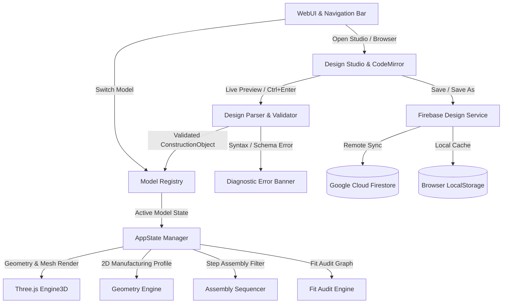

# PuzzleCore Architecture & Technical Overview

## 1. System Vision & Paradigm Shift

PuzzleCore has transitioned from a static file-bound CAD viewer into a **Dynamic, Data-Driven 3D Physical Construction Platform**. 

Previously, changing or testing a design required manual edits to static JavaScript files in a code editor, saving to disk, and performing a hard browser refresh. With the dynamic platform:
1. Designs are created, pasted, and edited **directly inside the WebUI** via an integrated Code Studio.
2. Code evaluation happens in a **sandboxed client-side ES module engine** without crashing the browser or the 3D scene.
3. Live 3D assembly updates occur **instantaneously without page reload**.
4. Every design can be named, versioned, tagged, and persisted to **Google Firebase Firestore** with local storage offline synchronization.
5. Multiple designs (e.g. *Football Court 1*, *Football Court 2*, *Modern House 1*, *Tiger 1*) coexist independently and can be opened, cloned, exported, or deleted on demand.

---

## 2. High-Level System Architecture

---

## 3. Core Subsystems

### 3.1. Client-Side Evaluation & Sandboxing (`js/services/design-parser.js`)
* **Blob Module Execution**: User code is packaged into an isolated `Blob` of MIME type `application/javascript` and dynamically imported via `import(blobUrl)`. This grants native support for ES module statements (`export const`, `export default`, destructuring, arrow functions) while isolating lexical scope.
* **Non-Destructive Error Isolation**: If user code has syntax errors or runtime exceptions, execution is intercepted in a `try...catch` block. The active 3D scene remains completely unaffected.
* **Normalized Error Diagnostics**: Parse failures extract exact line and column numbers and generate human-friendly suggested fixes (e.g., missing commas, undeclared constants, unclosed brackets).

### 3.2. Persistence Layer & Dual Synchronization (`js/services/firebase-designs.js`)
* **Google Firebase Firestore**: Connected via Firebase JS SDK v10 (ES modules CDN). Collection `designs` holds documents containing metadata, code, part counts, version numbers, and canvas-generated preview thumbnails.
* **Local Storage Cache**: Every save or update is simultaneously written to `localStorage` under `puzzlecore_designs_cache_v1`. If the client is offline, has firewall restrictions, or experiences network interruptions, all CRUD operations proceed smoothly without interruption.
* **Slug Generation & Identity**: Unique identifiers are created using alphanumeric slugging with pseudo-random salt suffixes (e.g. `football-court-2-a7x9`).

### 3.3. Universal Model Registry (`js/models/registry.js`)
* **Unified Registry**: Houses both static built-in models (`my-model.js`, `cathedral.js`, `simple-house.js`) and dynamic cloud-loaded models.
* **Dynamic Registration**: New models can be registered on the fly using `ModelRegistry.registerDynamicDesign(design)`.
* **Observer Pattern**: Subscribed UI components (such as the global navigation model selector) are notified on model additions and re-render without requiring page reloads.

### 3.4. 3D Assembly & Geometry Engines (`js/assembly/engine3d.js`, `js/core/geometry.js`)
* **Parametric Extrusion**: Shapes are defined as 2D polygonal outlines with inner cutouts, then extruded in Three.js along the Z-axis by `materialThickness` (e.g., 1.0mm, 2.0mm, 3.0mm, 4.0mm).
* **Kerf & Fit Clearance Compensation**: Slot widths and tenon tabs are dynamically adjusted at runtime based on the selected material profile.
* **Camera Sightlines & Exploded View**: Custom bookmarks and step-by-step assembly sequencing are respected across all dynamic models.

---

## 4. Lifecycle of a Dynamic Design

1. **Creation**: User clicks `⚡ Design Studio` or `New Design` in the navbar.
2. **Authoring**: Code is written or pasted into the CodeMirror editor, or loaded from built-in templates.
3. **Live Preview**: Pressing `▶ Live Preview` (or `Ctrl+Enter`) evaluates the code. If valid, the model is registered and rendered in the 3D scene immediately.
4. **Thumbnail Generation**: When the user clicks `Save`, a high-resolution snapshot is captured from the active Three.js `<canvas>` via `toDataURL('image/jpeg', 0.6)`.
5. **Persistence**: The design metadata, raw JS code, and thumbnail are committed to Firestore and cached locally.
6. **Cross-Workbench Inspection**: The active model is available to all workbenches (`inspector.html`, `manufacturing.html`, `validation.html`, `guide.html`).
