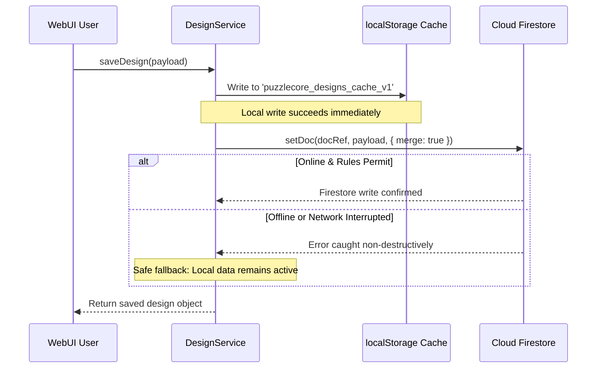

# Firebase Cloud Firestore Data Model & Persistence

PuzzleCore utilizes **Google Cloud Firestore** as its primary cloud persistence store, augmented by an automated **localStorage** synchronization fallback.

---

## 1. Firestore Collection Structure

All user designs are stored in the root collection:
`/designs/{designId}`

### Document Schema
```typescript
interface FirestoreDesignDocument {
  id: string;               // Document ID (slug string, e.g. "football-arena-2-x41k")
  name: string;             // Human-readable title (e.g. "Football Arena 2")
  category: string;         // Classification (e.g. "Sports", "Architecture")
  description: string;      // Optional user notes
  jsCode: string;           // Complete source code of the design definition
  partCount: number;        // Total parts in the model
  difficulty: string;       // e.g. "Level 2 — Intermediate"
  dimensions: string;       // e.g. "120x80x45mm"
  thumbnail: string | null; // Data URL (image/jpeg compressed to ~15-25 KB)
  tags: string[];           // Search keywords
  version: number;          // Monotonically increasing revision counter (1, 2, 3...)
  author: string;           // Author identifier ("User")
  createdAt: Timestamp;     // ISO String or Firestore serverTimestamp
  updatedAt: Timestamp;     // Last modification timestamp
}
```

---

## 2. Thumbnail Capture Strategy

To avoid storing megabytes of raw image data or uncompressed canvas frames, thumbnails are captured from the active Three.js rendering context:
```javascript
const thumbnail = engine.renderer.domElement.toDataURL('image/jpeg', 0.6);
```
* Canvas resolution is automatically downsampled and compressed using lossy JPEG at 60% quality.
* Average document size remains lightweight (~20 KB), well within Firestore's 1 MB per document limit.

---

## 3. Dual Persistence & Offline Fallback Workflow



---

## 4. Security Rules (`firestore.rules`)

```javascript
rules_version = '2';
service cloud.firestore {
  match /databases/{database}/documents {
    match /designs/{designId} {
      allow read, write: if true; // Public collaborative prototype
    }
  }
}
```
*(Production enterprise deployments can replace `if true;` with `request.auth != null` for user-isolated data).*
