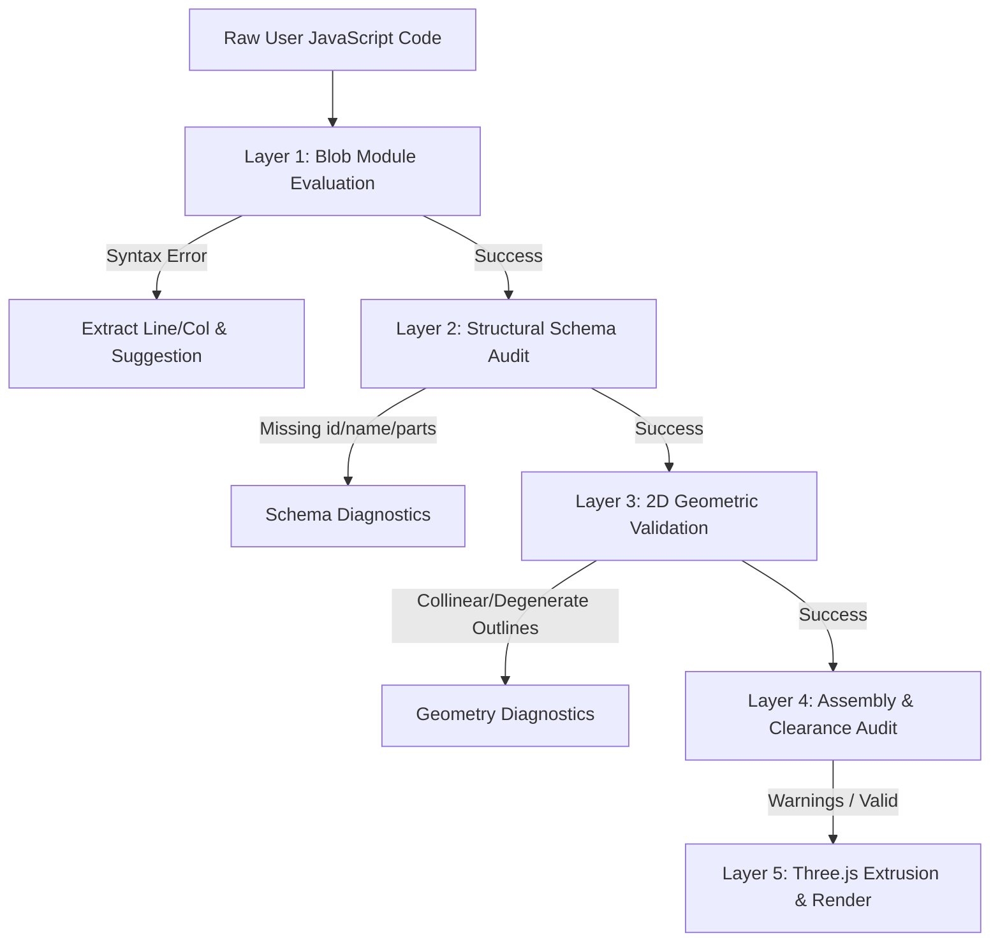

# Multi-Tier Validation & Diagnostic System

To guarantee that user-provided JavaScript never crashes the 3D rendering context or corrupts manufacturing files, PuzzleCore applies a 5-layer validation pipeline.

---

## 1. The Validation Pipeline

---

## 2. Layer-by-Layer Verification Rules

### Layer 1: Lexical & Syntax Verification
* Evaluates code via dynamic ES Module Blob.
* Captures parse errors (e.g. `Unexpected token '}'`, `is not defined`).
* Maps stack trace line offsets to the user's CodeMirror editor.

### Layer 2: Schema Audit
* `id`: Must be a valid string conforming to `/^[a-zA-Z0-9_-]+$/`.
* `name`: Must be non-empty string.
* `parts`: Must be an array containing $\ge 1$ item.
* **Uniqueness Constraint**: All `parts[i].id` values must be strictly unique. Duplicates trigger an immediate diagnostic error.

### Layer 3: 2D Geometry Integrity
* **Outline Point Count**: Must have $\ge 3$ vertices.
* **Coordinate Types**: Every vertex `[x, y]` must consist of valid finite numbers (`!isNaN`).
* **Cutout Dimensions**: Every cutout `{ x, y, w, h }` must satisfy $w > 0$ and $h > 0$.
* **Boundary Containment**: Cutouts must not extend outside the enclosing outline polygon.

### Layer 4: Slot/Tab Tolerances & Clearance Audit
* Interlocking slots must allow clearance for sheet thickness (nominal $3.0\text{ mm} \implies 3.1 \sim 3.2\text{ mm}$ cutout width).
* Zero-clearance slots trigger non-fatal warnings recommending fit allowance.

### Layer 5: Assembly Graph Reachability
* Connections referencing non-existent part IDs generate contextual warnings in the audit panel without blocking rendering.
